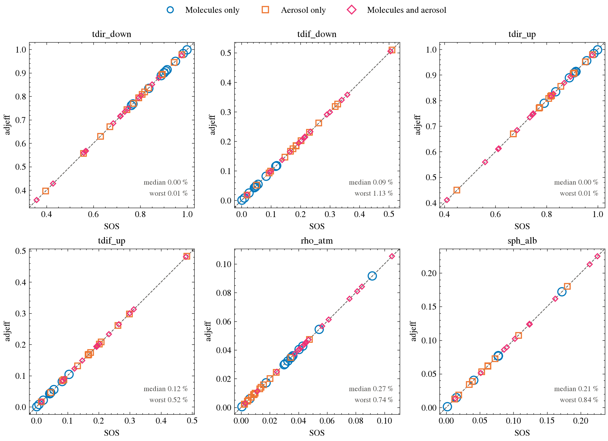
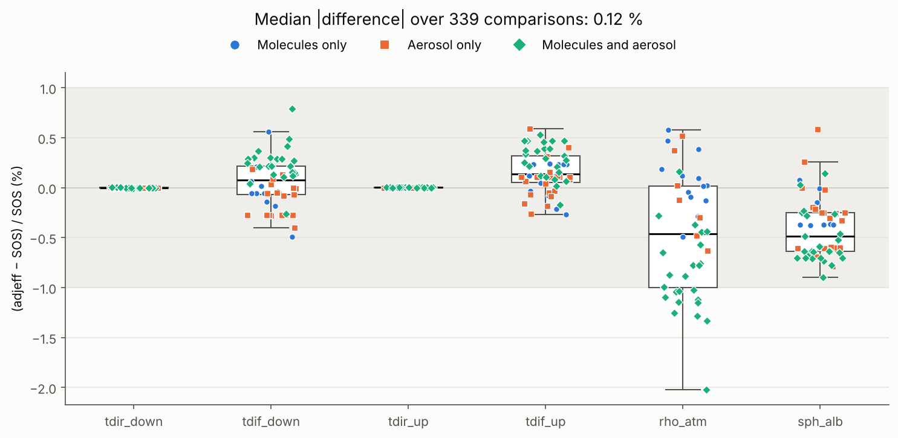
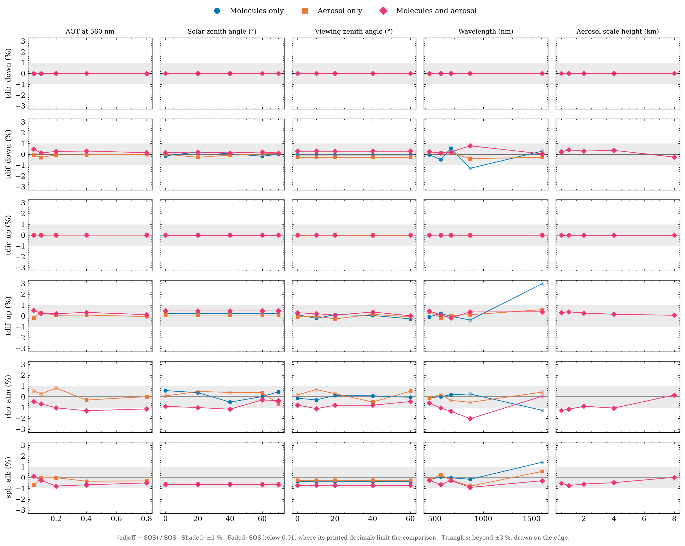

# Validation of the `adjeff` library with `SOS_ABS_V5.1`

> [!note]
> See [report.md](results/report.md) for the full comparisons.

This repository is made to validate the six radiative terms of the 5S model that [adjeff](https://github.com/walcark/Adjeff) computes with the Smart-G Monte Carlo code against [SOS](https://github.com/CNES/RadiativeTransferCode-SOS), the CNES successive-orders-of-scattering code.

| Term | |
|---|---|
| `tdir_down`, `tdif_down` | Direct and diffuse transmittances, sun to surface |
| `tdir_up`, `tdif_up` | Direct and diffuse transmittances, surface to sensor |
| `rho_atm` | Path reflectance |
| `sph_alb` | Spherical albedo |

## Results

The median relative difference over 339 comparisons is **0.06 %** on average over the six parameters.

| Term | Worst relative difference | Where |
|---|---|---|
| `tdir_down`, `tdir_up` | 0.01 % | |
| `rho_atm` | 0.74 % | aerosol only, `sza = 70` |
| `sph_alb` | 0.84 % | aerosol only, 665 nm |
| `tdif_down` | 1.13 % | aerosol only, 1610 nm |
| `tdif_up` | 0.52 % | mixed, 665 nm |

Atmospheres were computed for several different atmospheric variables (AOT, solar angle, viewing angle, wavelength, aerosol scale height), over three atmospheres types (molecules only, aerosol only, both). The full tables are in [`results/report.md`](results/report.md), every number in [`results/report.json`](results/report.json).

The signed median difference per term and per atmosphere is given below (in %):

| Atmosphere | `tdir_down` | `tdif_down` | `tdir_up` | `tdif_up` | `rho_atm` | `sph_alb` | All terms |
|---|---|---|---|---|---|---|---|
| Molecules only | +0.00 | -0.00 | +0.00 | -0.02 | +0.12 | -0.14 | 0.05 |
| Aerosol only | -0.00 | -0.06 | +0.00 | +0.02 | -0.16 | -0.09 | 0.06 |
| Both | -0.00 | -0.02 | +0.00 | +0.10 | -0.21 | -0.08 | 0.06 |

The last column is the median of the absolute difference (in %) over all six terms.

> [!note]
> These values hold only against an SOS compiled for 500 vertical layers. If SOS is used with its default number of vertical layers, the error is significantly more important in average (0.25%).



Every point is on `y = x`. The relative differences is provided below:



The relative difference against each swept parameter is provided below:



## Running the comparison

The run requires a CUDA GPU for `adjeff` and the `Smart-G` auxiliary data.

```bash
pixi install
pixi run build-sos                 # clone and compile SOS, once
export SMARTG_DIR_AUXDATA=/path/to/smartg/auxdata
pixi run validate                  # about 30 minutes; writes results/report.*
pixi run validate --sweeps aot --atmospheres aerosol
pixi run plots                     # results/figures/, from results/report.json
```

## Method

Both codes get the same atmosphere, so only the radiative transfer can differ:

| Held identical | How |
|---|---|
| Aerosol optics | SOS reads the CAMS scattering matrix Smart-G uses, interpolated in wavelength and humidity |
| Optical depths | Molecular and aerosol depths are read from adjeff's Smart-G atmosphere and forced on SOS |
| Gas absorption | Off in both |
| Phase function | Not truncated, since truncation would renormalise the depth |
| Vertical resolution | SOS is compiled for 500 layers rather than the default value of 100 |
